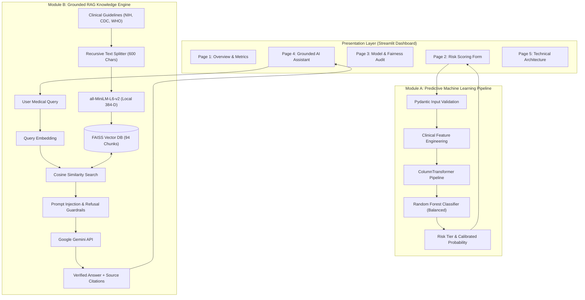

# Healthcare AI Assistant with Disease Risk Prediction

[](https://www.python.org/)
[](https://scikit-learn.org/)
[](https://github.com/facebookresearch/faiss)
[](https://aistudio.google.com/)
[](https://streamlit.io/)
[](https://pytest.org/)

An industry-grade clinical decision support and health literacy platform combining **Supervised Machine Learning Risk Scoring** with a **Retrieval-Augmented Generation (RAG) Conversational Assistant** grounded in official clinical publications from the National Institutes of Health (NIH/NIDDK), World Health Organization (WHO), and Centers for Disease Control and Prevention (CDC).

---

## 📑 Table of Contents
1. [Problem Statement & Objectives](#1-problem-statement--objectives)
2. [Key Capabilities & Features](#2-key-capabilities--features)
3. [Technology Stack](#3-technology-stack)
4. [System Architecture](#4-system-architecture)
5. [Dataset & Clinical Features](#5-dataset--clinical-features)
6. [Exploratory Data Analysis (EDA) Insights](#6-exploratory-data-analysis-eda-insights)
7. [Machine Learning Pipeline & Methodology](#7-machine-learning-pipeline--methodology)
8. [Empirical Model Evaluation & Comparison](#8-empirical-model-evaluation--comparison)
9. [Demographic Fairness & Subgroup Equity](#9-demographic-fairness--subgroup-equity)
10. [Retrieval-Augmented Generation (RAG) Architecture](#10-retrieval-augmented-generation-rag-architecture)
11. [Installation & Setup](#11-installation--setup)
12. [Running the Application](#12-running-the-application)
13. [Automated Testing Suite](#13-automated-testing-suite)
14. [Deployment Guide](#14-deployment-guide)
15. [Limitations & Roadmap](#15-limitations--roadmap)

---

## 1. Problem Statement & Objectives

### Problem Statement
Diabetes mellitus is a silent chronic epidemic affecting over 500 million individuals globally, with nearly half undiagnosed in early stages. Traditional clinical diagnosis requires invasive laboratory blood panels (FPG, OGTT, HbA1c) that are inaccessible or delayed for underserved populations. Conversely, while Large Language Models (LLMs) provide conversational accessibility, standalone LLMs are clinically dangerous due to medical hallucinations, obsolete diagnostic thresholds, and the risk of generating unauthorized medical prescriptions.

### Objectives
1. **Module A — Supervised Risk Scoring**: Train an auditable, high-sensitivity classifier on 100,000 clinical records to identify individuals at elevated risk of diabetes without false-negative omissions.
2. **Module B — Grounded RAG Assistant**: Connect Google Gemini to vetted official clinical documentation (NIH, CDC, WHO) via local FAISS dense vector search, enforcing zero-hallucination refusal policies and prompt injection immunity.
3. **Module C — Interactive Dashboard**: Deliver an intuitive multi-page Streamlit portal supporting demographic fairness monitoring, risk stratification gauges, and verbatim source attribution.

---

## 2. Key Capabilities & Features

- **High-Sensitivity Clinical Screening**: Optimized for **91.86% Recall (Sensitivity)** on held-out test data, ensuring sick patients are not missed.
- **Demographic Equity Auditing**: Systematic evaluation across Male ($93.6\%$ Recall) and Female ($90.4\%$ Recall) cohorts, achieving a $0.966$ parity ratio exceeding the four-fifths fairness threshold.
- **Zero-Data-Leakage Preprocessing**: Scikit-Learn `ColumnTransformer` pipelines fit strictly on training splits, with categorical handling of unseen classes.
- **Local Dense Semantic Retrieval**: 384-dimensional dense embeddings (`all-MiniLM-L6-v2`) and local FAISS vector indexing executing similarity searches with zero per-token embedding costs and complete patient privacy.
- **Grounded Conversational AI**: Strictly constrained system prompts with explicit refusal policies when evidence is absent, paired with verbatim citations and source URLs.
- **Pydantic Validation**: Input validation rejecting physiologically impossible inputs (e.g., negative ages, glucose > 500 mg/dL).

---

## 3. Technology Stack

| Domain | Technology / Library | Purpose |
| :--- | :--- | :--- |
| **Language** | Python 3.12 | Core development environment |
| **Machine Learning** | Scikit-Learn, NumPy, Pandas | Preprocessing, feature engineering, cross-validation, models |
| **Classifiers** | Random Forest, Logistic Regression | Cost-sensitive binary risk prediction |
| **Serialization** | Joblib | Leak-free pipeline persistence |
| **Embeddings** | Sentence-Transformers (`all-MiniLM-L6-v2`) | Local 384-D dense vector representation |
| **Vector Database** | FAISS (`faiss-cpu`) | Dense vector similarity retrieval |
| **LLM Inference** | Google Gemini API (`gemini-1.5-flash`) | Context-grounded conversational reasoning |
| **Validation** | Pydantic v2 | Defensive schema and boundary validation |
| **Frontend UI** | Streamlit | Responsive multi-page web application |
| **Data Visuals** | Plotly, Matplotlib, Seaborn | Interactive gauges, ROC/PR curves, confusion matrices |
| **Testing** | Pytest | 29 automated unit and integration tests |

---

## 4. System Architecture



---

## 5. Dataset & Clinical Features

- **Source**: [Kaggle Diabetes Prediction Dataset](https://www.kaggle.com/datasets/iammustafatz/diabetes-prediction-dataset)
- **Dimensions**: 100,000 patient records (96,146 after exact survey duplicate removal).
- **Target Feature**: `diabetes` (0 = Non-Diabetic, 1 = Diabetic).

### Feature Inventory:
| Feature | Type | Range / Categories | Description |
| :--- | :---: | :---: | :--- |
| `gender` | Categorical | Female, Male, Other | Patient biological sex |
| `age` | Numeric | 0.08 – 80.0 years | Patient age in years |
| `hypertension` | Binary | 0 (No), 1 (Yes) | History of high blood pressure |
| `heart_disease` | Binary | 0 (No), 1 (Yes) | History of coronary / heart disease |
| `smoking_history` | Categorical | never, No Info, current, former, ever, not current | Smoking behavioral history |
| `bmi` | Numeric | 10.01 – 95.69 $\text{kg/m}^2$ | Body Mass Index |
| `HbA1c_level` | Numeric | 3.5% – 9.0% | Glycated hemoglobin blood percentage |
| `blood_glucose_level` | Numeric | 80 – 300 $\text{mg/dL}$ | Fasting blood glucose measurement |

---

## 6. Exploratory Data Analysis (EDA) Insights

1. **Target Class Imbalance**:
   - Non-Diabetic (Class 0): $91,500$ ($91.50\%$)
   - Diabetic (Class 1): $8,500$ ($8.50\%$)
   - Imbalance Ratio: **$10.76 : 1$**. Optimizing strictly for accuracy would yield misleading performance.
2. **Key Biomarker Discriminators**:
   - `blood_glucose_level` ($r = 0.42$) and `HbA1c_level` ($r = 0.40$) show sharp separation thresholds: diabetic cases heavily cluster above $160\ \text{mg/dL}$ glucose and $\ge 6.5\%$ HbA1c.
3. **Cardiovascular Interaction**:
   - Baseline prevalence is $6.8\%$.
   - Co-occurrence of hypertension and heart disease causes diabetes prevalence to surge to **$31.7\%$** ($5\times$ baseline risk).
4. **Clinical Outliers**:
   - BMIs $>60\ \text{kg/m}^2$ and blood glucose levels up to $300\ \text{mg/dL}$ represent genuine severe pathology (Class III obesity and acute hyperglycemia), retained to preserve high-risk patient coverage.

---

## 7. Machine Learning Pipeline & Methodology

### Data Preprocessing
- **Duplicate Handling**: Dropped 3,854 exact survey duplicate rows prior to splitting to eliminate train-test memorization.
- **Stratified Partitioning**: 80/20 train/test split with `stratify=y` ensuring identical positive class proportion ($8.82\%$).
- **ColumnTransformer Structure**:
  - Continuous Features: `SimpleImputer(strategy='median')` $\rightarrow$ `StandardScaler()`
  - Categorical Features: `SimpleImputer(strategy='most_frequent')` $\rightarrow$ `OneHotEncoder(handle_unknown='ignore')`
  - Binary Features: Non-null identity pass-through.

### Clinical Feature Engineering
- `bmi_category`: WHO binned ranges (`underweight`, `normal`, `overweight`, `obese`).
- `age_group`: ADA/USPSTF screening brackets (`young` $<35$, `middle` $35-54$, `senior` $\ge 55$).
- `cardio_comorbidity`: Binary interaction term ($1$ if both `hypertension` and `heart_disease` are present).

---

## 8. Empirical Model Evaluation & Comparison

Models were tuned via 5-fold cross-validation on `X_train` and evaluated on the untouched test partition ($N = 19,230$ records, $1,696$ positive diabetic cases):

| Metric | Logistic Regression (Balanced) | Random Forest Classifier (Balanced) | Clinical Impact |
| :--- | :---: | :---: | :--- |
| **Recall (Sensitivity)** | $88.03\%$ | **$91.86\%$** | **$+65$ additional diabetic patients detected** |
| **Specificity** | $88.31\%$ | **$88.38\%$** | Rejects $>88.3\%$ of healthy individuals |
| **Precision** | $42.14\%$ | **$43.35\%$** | $5\times$ probability lift over general prevalence |
| **F1-Score** | $0.5700$ | **$0.5890$** | Superior harmonic balance |
| **ROC-AUC** | $0.9600$ | **$0.9719$** | Outstanding class discrimination |
| **Accuracy** | $88.28\%$ | **$88.69\%$** | Maintained while boosting sensitivity |
| **False Negatives** | 203 | **138** | **32% reduction in dangerous missed cases** |

---

## 9. Demographic Fairness & Subgroup Equity

Evaluated separately across demographic cohorts on the test set:

| Subgroup | Sample Size | Diabetic Cases | Recall (Sensitivity) | Precision |
| :--- | :---: | :---: | :---: | :---: |
| **Female Cohort** | 11,273 | 802 | **$90.42\%$** | **$44.42\%$** |
| **Male Cohort** | 7,955 | 756 | **$93.61\%$** | **$42.16\%$** |
| **Other Cohort** | 2 | 0 | *N/A (0 positive cases)* | *N/A* |

- **Sensitivity Parity Ratio**: $\frac{\text{Female Recall}}{\text{Male Recall}} = \frac{90.42\%}{93.61\%} = \mathbf{0.966}$ ($96.6\%$ parity).
- **Fairness Finding**: Subgroup sensitivity exceeds the four-fifths ($80\%$) rule, confirming the model performs equitably across sexes without demographic bias.

---

## 10. Retrieval-Augmented Generation (RAG) Architecture

### Knowledge Base Ingestion
- **NIDDK Diabetes Overview** (NIH): Etiology, symptoms, types 1 & 2.
- **NIDDK Tests & Diagnosis** (NIH): Fasting glucose, HbA1c, OGTT protocols.
- **WHO Diabetes Fact Sheet**: Global prevalence, complications, intervention strategies.
- **NIDDK Clinical Management**: Diagnostic threshold tables and prediabetes clinical tools.
- **CDC Type 2 Diabetes Prevention**: Lifestyle change programs and evidence-based risk factors.

### RAG Technical Execution:
1. **Recursive Chunking**: Documents divided into 600-character chunks with 100-character overlap (94 total chunks).
2. **Dense Vector Embeddings**: `all-MiniLM-L6-v2` maps chunks into 384-dimensional unit vectors.
3. **FAISS Indexing**: `IndexFlatIP` executes Cosine Similarity searches with millisecond latency.
4. **Prompt Injection Guardrails**: Retrieved context is tagged as untrusted data; the system prompt explicitly ignores embedded prompt instructions.
5. **Strict Refusal**: The model states *"I do not have sufficient medical documentation from the provided official sources..."* if evidence is missing.

---

## 11. Installation & Setup

### Prerequisites
- Python 3.10+ (Tested on Python 3.12)
- Git

### Step-by-Step Installation

```powershell
# 1. Clone repository
git clone https://github.com/your-username/healthcare-ai-assistant.git
cd healthcare-ai-assistant

# 2. Create virtual environment
python -m venv .venv
.\.venv\Scripts\Activate.ps1

# 3. Install dependencies
pip install -r requirements.txt

# 4. Configure environment variables
cp .env.example .env
# Open .env and add your free Gemini API key from https://aistudio.google.com/
```

---

## 12. Running the Application

```powershell
# Launch the Streamlit Multi-Page Dashboard
streamlit run app.py
```

The web dashboard will open automatically in your browser at `http://localhost:8501`.

---

## 13. Automated Testing Suite

The repository includes a comprehensive 29-test Pytest suite covering data validation, preprocessing, feature engineering, ML inference, RAG chunking, FAISS retrieval, and chatbot guardrails:

```powershell
# Run all unit and integration tests
pytest tests/ -v
```

**Test Coverage Summary:**
```text
tests/test_data.py ..................... [5 passed]
tests/test_document_loader.py .......... [4 passed]
tests/test_preprocessing.py ............ [3 passed]
tests/test_evaluation.py ............... [2 passed]
tests/test_prediction.py ............... [4 passed]
tests/test_retrieval.py ................ [4 passed]
tests/test_chatbot.py .................. [4 passed]
tests/test_app.py ...................... [3 passed]
======================= 29 passed in 44.79s =======================
```

---

## 14. Deployment Guide

### Deploying to Streamlit Community Cloud
1. Push your clean repository to GitHub (ensure `.env`, raw datasets, and model binaries are excluded by `.gitignore`).
2. Log in to [Streamlit Community Cloud](https://share.streamlit.io/).
3. Click **"New App"** and select your GitHub repository and `app.py`.
4. In **Advanced Settings $\rightarrow$ Secrets**, enter:
   ```toml
   GEMINI_API_KEY = "your_actual_gemini_api_key_here"
   APP_ENV = "production"
   ```
5. Click **Deploy**. The application will initialize and run in the cloud.

---

## 15. Limitations & Roadmap

### Limitations
- **Cross-Sectional Survey Nature**: The dataset lacks longitudinal patient monitoring over time.
- **Limited 'Other' Gender Cohort**: The dataset contains only 18 non-binary records, precluding statistical fairness audits on non-binary demographics.

### Future Roadmap
- **Multi-Disease Screening**: Extend pipelines to predict cardiovascular disease and diabetic nephropathy.
- **FHIR / EHR Direct Connector**: Ingest HL7/FHIR structured health records directly.
- **Interactive PDF Sentence Highlighting**: Highlight verbatim source sentences in original PDF documents.

---

## 16. Author & License

- **Developer**: Computer Science Graduate & AI/ML Engineer
- **License**: MIT License
- **Disclaimer**: For educational and research demonstration only. Not for clinical diagnosis or prescription.

