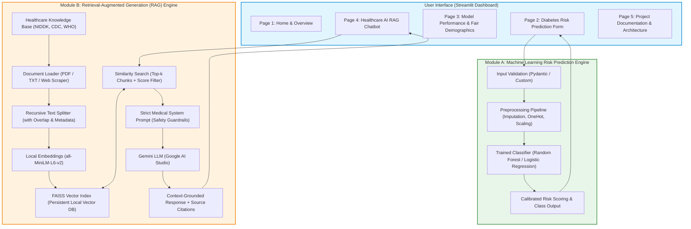

# System Architecture

## Healthcare AI Assistant with Disease Risk Prediction

This document defines the high-level system architecture, design principles, and component interactions for the **Healthcare AI Assistant**.

---

## 1. High-Level Architecture Diagram

---

## 2. Architectural Pillars

### 2.1 Decoupling and Modularity
The codebase separates concerns into isolated layers:
- `src/data/`: Data loading and validation schemas.
- `src/features/`: Feature engineering and transformations.
- `src/ml/`: Training, evaluation, prediction pipelines, and fairness assessment.
- `src/rag/`: Document ingestion, chunking, vector indexing, retrieval, and LLM communication.
- `src/utils/`: Shared utilities, logging, and validation helpers.
- `app.py`: Streamlit presentation layer strictly calling `src/` modules.

### 2.2 Dual-Engine Design
1. **Deterministic / Statistical Machine Learning (Module A)**:
   - Predicts risk category (`Non-Diabetic` vs `Diabetic`) from patient biometrics.
   - Operates entirely locally with Scikit-learn pipelines, ensuring millisecond inference, zero external API costs, and full interpretability.
2. **Generative RAG Engine (Module B)**:
   - Provides contextual, medical-grade question answering based solely on trusted clinical guidelines (NIH, CDC, WHO).
   - Eliminates hallucination by enforcing context-grounded prompt constraints and displaying source attribution.

### 2.3 Responsible AI & Safety Guardrails
- **Medical Disclaimer**: Clear alerts reminding users that the assistant is an educational tool, not a diagnostic or prescribing physician.
- **Subgroup Parity**: Explicit evaluation across demographic groups (male vs female) to detect and document performance disparities.
- **Untrusted Context Guardrails**: RAG prompts treat retrieved knowledge as reference facts, neutralizing prompt injection attempts embedded in source texts.

