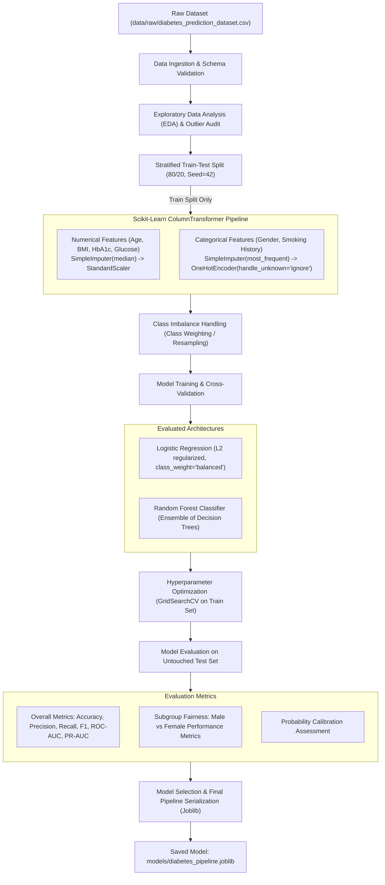

# Machine Learning Workflow

## End-to-End Pipeline for Diabetes Risk Prediction

This document describes the design, training strategy, validation protocol, and deployment lifecycle of the Machine Learning classification pipeline.

---

## 1. Machine Learning Lifecycle Diagram

---

## 2. Key Methodological Decisions

### 2.1 Preventing Data Leakage
- Preprocessing steps (imputation statistics, scaling means/standard deviations, and categorical encoder vocabularies) are **fit solely on the training partition**.
- The testing split is transformed using the fitted pipeline without re-estimating any parameters.

### 2.2 Class Imbalance Handling
- Medical datasets frequently suffer from class imbalance (e.g., ~8-10% positive diabetic cases).
- Optimizing strictly for raw accuracy yields misleading results (a model predicting everyone as non-diabetic could achieve 90% accuracy while failing 100% of diabetic patients).
- We prioritize **Recall** (Sensitivity) and **F1-Score / ROC-AUC**, employing cost-sensitive learning (`class_weight='balanced'`) to penalize false negatives severely.

### 2.3 Subgroup & Fairness Auditing
- Models can exhibit disparate error rates across demographic cohorts (e.g., differing sensitivity in men vs women).
- We systematically evaluate test performance sliced by gender to document model reliability across all user groups.

